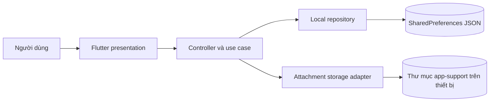
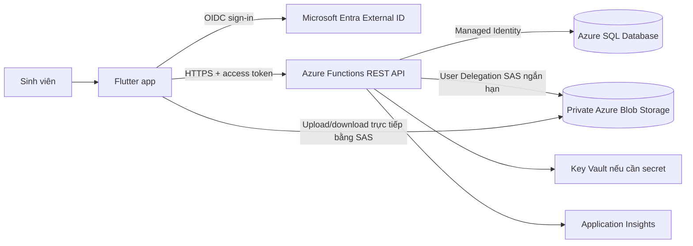
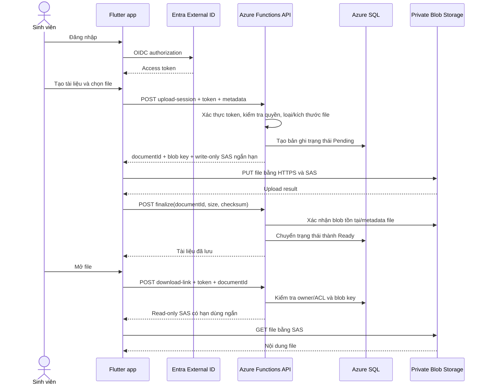

# Báo cáo phân tích và đề xuất tích hợp Cloud

> Báo cáo này lưu lại phương án Azure của bài phân tích trước. Phần triển khai theo yêu cầu Firebase/Supabase hiện tại, bao gồm cách cấu hình và kiểm thử, nằm trong [firebase-supabase-setup.md](firebase-supabase-setup.md).

- **Ứng dụng:** Cashew Study Library
- **Ngày phân tích:** 07/10/2026
- **Phạm vi:** Đánh giá mã nguồn hiện tại và thiết kế phương án chuyển đổi; chưa triển khai hoặc kết nối tài nguyên Cloud thật.

## 1. Tóm tắt

Phiên bản hiện tại là ứng dụng Flutter client-centric, dữ liệu được lưu trên từng thiết bị. Ứng dụng chưa có backend, cơ sở dữ liệu tập trung, đăng nhập hay đồng bộ giữa thiết bị. Vì vậy, “mô hình truyền thống” trong báo cáo này được hiểu là mô hình lưu trữ cục bộ hiện có, không phải một hệ thống on-premises client-server đã tồn tại.

Đề xuất chuyển sang **Public Cloud trên Microsoft Azure**. Azure Functions cung cấp API có xác thực; Azure SQL Database lưu metadata; Azure Blob Storage lưu nội dung file riêng tư. Flutter giữ nguyên UI và use case, thay repository cục bộ bằng repository gọi API. File được tải trực tiếp lên/xuống Blob bằng SAS ngắn hạn do backend cấp, không nhúng khóa Cloud trong ứng dụng.

## 2. Phân tích hệ thống hiện tại

| Thành phần | Hiện trạng trong mã nguồn | Nhận xét |
| --- | --- | --- |
| Frontend | Flutter/Material trong `lib/presentation/`; `StudyDocumentController` quản lý trạng thái tại `lib/application/` | UI và state chạy trên thiết bị. Có CRUD, tìm kiếm, lọc, xem metadata và chọn/mở file. |
| Backend/API | Chưa có | Use case gọi repository trực tiếp trong cùng tiến trình; không có xác thực người dùng hoặc endpoint mạng. |
| Database/metadata | Chưa có DB server. `SharedPreferencesDocumentDataSource` serialize toàn bộ danh sách thành một JSON string dưới khóa `study_documents_v2` | Dùng được cho bộ dữ liệu nhỏ, một thiết bị; không có truy vấn phía server, transaction đa người dùng hoặc đồng bộ. |
| File storage | Trên nền tảng hỗ trợ IO, file được chép vào thư mục `attachments` dưới `getApplicationSupportDirectory()`; `open_filex` mở bằng ứng dụng mặc định | File thuộc về thiết bị cài app. Web hiện dùng stub, không có luồng lưu file cục bộ tương đương. |
| Domain/repository | Entity, use case và `StudyDocumentRepository` nằm trong `lib/domain/` | Hợp đồng repository là điểm thay thế phù hợp để chuyển sang remote API mà ít ảnh hưởng UI. |
| Danh tính và phân quyền | Chưa có tài khoản hoặc owner ID | Không thể phân biệt dữ liệu của nhiều sinh viên hay chia sẻ theo quyền. |

### Sơ đồ hiện tại

Các mẫu khởi tạo trong data source là dữ liệu minh họa; chúng không đại diện cho một kho dữ liệu dùng chung giữa các người dùng.

## 3. Hạn chế và điểm nghẽn của mô hình hiện tại

| Hạn chế | Hệ quả khi sử dụng thực tế |
| --- | --- |
| Metadata và file chỉ nằm trên một thiết bị | Đổi/mất/hỏng thiết bị hoặc gỡ ứng dụng có thể làm mất dữ liệu; không truy cập cùng kho từ máy khác. |
| Không có API và danh tính người dùng | Không thể đồng bộ, chia sẻ, thu hồi quyền, theo dõi ai đã tải lên hoặc giới hạn dữ liệu theo sinh viên. |
| Lưu danh sách thành một JSON string | Mỗi lần sửa/xóa phải đọc và ghi lại danh sách; khó mở rộng khi có nhiều file/metadata và không có transaction hoặc truy vấn chỉ mục. |
| File đi cùng vòng đời thiết bị | Không có backup tập trung, versioning hay chính sách lưu trữ; dung lượng phụ thuộc thiết bị. |
| Không có kiểm soát tập trung | Không có audit log, chính sách mật khẩu/SSO, phân quyền theo môn học hay quy trình xử lý file độc hại. |
| Truy cập từ xa phụ thuộc bản sao cục bộ | Muốn dùng nhiều thiết bị phải tự chuyển file; các bản sao có thể lệch nhau. |

## 4. Mô hình Cloud được đề xuất

### Lựa chọn: Public Cloud

Public Cloud phù hợp với ứng dụng học tập cần truy cập từ nhiều mạng/thiết bị nhưng chưa có đội vận hành hạ tầng riêng. Dùng dịch vụ managed giảm công việc cài đặt và vá máy chủ. Dữ liệu vẫn được bảo vệ bằng xác thực, quyền tối thiểu và container Blob riêng tư; “Public Cloud” không có nghĩa là công khai file.

Private Cloud cần chi phí vận hành và năng lực quản trị cao hơn, chưa tương xứng quy mô bài tập. Hybrid Cloud có thể cân nhắc nếu trường bắt buộc giữ dữ liệu định danh trong hạ tầng nội bộ, nhưng chưa có yêu cầu đó.

### Dịch vụ Azure

| Dịch vụ | Vai trò đề xuất |
| --- | --- |
| Azure Functions | REST API cho CRUD, xác thực quyền sở hữu tài liệu, cấp quyền upload/download ngắn hạn và hoàn tất giao dịch metadata. |
| Azure Blob Storage | Lưu file trong private container; khóa blob chỉ lưu trong metadata, không bật anonymous access. |
| Azure SQL Database (serverless khi phù hợp) | Lưu metadata, owner, quyền truy cập và trạng thái upload. Quan hệ và truy vấn lọc theo owner/môn học phù hợp mô hình quan hệ. |
| Microsoft Entra External ID | Đăng nhập người dùng bên ngoài tổ chức và cấp token OIDC/OAuth cho ứng dụng. Có thể thay bằng identity provider của trường nếu đã có SSO. |
| Azure Key Vault và Managed Identity | Bảo vệ secret/certificate cần thiết; Function dùng managed identity truy cập SQL/Blob, tránh lưu khóa trong source hoặc app Flutter. |
| Application Insights | Thu thập log, lỗi API, độ trễ và truy vết thao tác vận hành; không ghi nội dung tài liệu hay token vào log. |

Azure API Management có thể đặt trước Functions khi cần quota, versioning API, policy hoặc nhiều client; chưa bắt buộc cho MVP vì tăng chi phí và cấu hình.

### Sơ đồ kiến trúc mục tiêu

## 5. Luồng dữ liệu Cloud

Luồng `Pending -> Ready` tránh hiển thị tài liệu trước khi upload xong. Nếu upload hoàn tất nhưng finalize thất bại, backend cần retry/timeout cleanup bản ghi Pending và blob mồ côi. Thao tác xóa cũng do API kiểm tra quyền rồi xóa metadata/blob theo chính sách retention.

## 6. So sánh trước và sau tích hợp

| Khía cạnh | Hiện tại: lưu cục bộ | Sau tích hợp: Azure Public Cloud |
| --- | --- | --- |
| Vị trí metadata | JSON trong SharedPreferences từng thiết bị | Azure SQL dùng chung, truy vấn theo owner/môn học/danh mục |
| Vị trí file | Thư mục app-support của thiết bị | Private Blob Storage, truy cập qua SAS ngắn hạn |
| Truy cập từ xa | Không; cần chuyển dữ liệu thủ công | Đăng nhập và tải từ thiết bị được cấp quyền qua Internet |
| Nhiều thiết bị/người dùng | Không có đồng bộ hoặc phân quyền | API trung tâm, owner/ACL và trạng thái đồng bộ |
| Khả năng mở rộng | Bị giới hạn bởi thiết bị và JSON toàn danh sách | Dung lượng Blob và compute/database có thể mở rộng độc lập |
| Backup/khôi phục | Phụ thuộc backup của người dùng/OS | Backup SQL, Blob versioning/soft delete và retention được cấu hình tập trung |
| Khả năng hoạt động offline | CRUD cục bộ có thể tiếp tục khi offline | Phụ thuộc mạng nếu chưa có cache/offline queue; nên giữ local cache và xử lý đồng bộ có kiểm soát |
| Bảo mật | Ranh giới bảo vệ chủ yếu là thiết bị | Có identity, ACL, audit, encryption, nhưng cần cấu hình đúng và giám sát |
| Chi phí | Hầu như không có phí dịch vụ Cloud; đổi lại người dùng tự chịu lưu trữ/backup | Trả theo compute, SQL, dung lượng, request, backup và egress; cần budget/alert |
| Độ trễ | Thấp khi đọc local | Có thêm network latency; upload lớn tốn băng thông, SAS direct-to-Blob tránh API thành nút nghẽn truyền file |

## 7. Bảo mật, chi phí và hiệu suất

### Bảo mật

- Yêu cầu đăng nhập; API xác thực token ở mọi thao tác và kiểm tra `ownerId`/ACL tại server. Không tin `ownerId` do client tự gửi.
- Blob container đặt private, chặn public/anonymous access. Không nhúng account key, connection string hoặc client secret trong Flutter.
- Backend dùng Managed Identity và RBAC quyền tối thiểu. SAS chỉ cấp cho đúng blob, đúng thao tác read/write, thời hạn ngắn; không cấp quyền list/container.
- Dùng HTTPS/TLS khi truyền, encryption at rest của dịch vụ; bật SQL auditing, log truy cập phù hợp và không ghi token/nội dung file.
- Kiểm tra dung lượng, MIME/type và phần mở rộng ở backend; giới hạn quota, chống upload trùng/độc hại và cân nhắc malware scanning trước khi chuyển trạng thái sang Ready.
- Cấu hình SQL point-in-time restore; bật Blob soft delete/versioning theo thời gian lưu phù hợp. Xác định region/data residency theo chính sách của trường.

### Chi phí

Không đưa ra số tiền cố định vì chưa có số người dùng, dung lượng, tần suất tải xuống và region. Chi phí tháng có thể ước tính theo:

`Compute Functions + SQL compute/storage/backup + Blob capacity/operations + bandwidth/egress + monitoring`.

Azure Functions consumption và SQL serverless có thể giảm chi phí lúc tải thấp, nhưng SQL serverless vẫn có mức phí lưu trữ và có thể phát sinh compute theo cấu hình. File tải ra Internet, backup, log retention và dung lượng tăng đều có thể thành chi phí đáng kể. Nên đặt budget alert, giới hạn kích thước/quota mỗi người dùng, lifecycle tier cho file ít truy cập và đo tải trước khi chọn SKU production. Dùng Azure Pricing Calculator với region, cấu hình và giả định thực tế trước triển khai.

### Hiệu suất và khả năng hoạt động

- Direct upload/download giữa app và Blob giảm tải băng thông cho Functions; Functions chỉ xác thực, cấp quyền và ghi metadata.
- Azure SQL cần index theo `ownerId`, `courseId`, `category`, `updatedAt`; API dùng pagination thay vì tải toàn bộ kho.
- Chọn region gần nhóm sinh viên chính. File lớn nên dùng upload block/chunk và retry có giới hạn.
- Duy trì cache cục bộ cho danh sách gần đây nếu cần offline; dùng `updatedAt`/ETag hoặc version để xử lý xung đột thay vì âm thầm ghi đè.
- Đo API latency, upload duration, lỗi xác thực và SQL query qua Application Insights; không giả định Cloud tự động làm ứng dụng nhanh hơn khi mạng yếu.

## 8. Lộ trình chuyển đổi

1. Chốt yêu cầu tài khoản, sharing, quota, file tối đa, retention, dữ liệu nhạy cảm, ngân sách và mức hỗ trợ offline.
2. Thiết kế schema SQL, API contract và quy tắc owner/ACL; giữ `StudyDocumentRepository` làm abstraction để UI/use case không gọi Azure trực tiếp.
3. Xây Azure Functions, Entra External ID, SQL, Blob private container, Managed Identity, Key Vault/monitoring; kiểm thử authorization và upload/download SAS.
4. Thêm remote repository/data source trong Flutter. Giữ local repository làm cache/offline adapter nếu cần; xử lý merge và trạng thái upload Pending/Ready.
5. Chuyển file/metadata hiện hữu bằng migration có checksum và mapping ID. Bản hiện tại không có tài khoản tập trung, nên cần quy tắc xác định chủ sở hữu trước khi nhập dữ liệu; các mẫu demo không cần chuyển sang production.
6. Chạy thử với nhóm nhỏ, kiểm tra khôi phục backup, quyền truy cập và chi phí; chỉ cutover sau khi có kế hoạch rollback và dữ liệu đối soát.

## 9. Kết luận và giả định cần xác nhận

Azure Public Cloud là hướng phù hợp nếu mục tiêu là kho tài liệu dùng chung, truy cập nhiều thiết bị và có phân quyền. Đề xuất Azure Functions + Azure SQL + Blob giữ được ranh giới repository/use case hiện có, đồng thời tách metadata khỏi file và áp dụng quyền truy cập tập trung. Đây là thiết kế mục tiêu, **chưa được triển khai trong source hiện tại**.

Trước production cần xác nhận: ứng dụng chỉ phục vụ một lớp hay nhiều trường; chia sẻ tài liệu theo cá nhân/môn học; dung lượng/tệp tối đa; yêu cầu dữ liệu lưu tại quốc gia/vùng nào; ngân sách; chính sách retention và mức offline. Nếu chỉ là bài tập chạy một thiết bị, mô hình local hiện tại đơn giản và rẻ hơn; Cloud chỉ đáng chuyển khi có nhu cầu truy cập từ xa/chia sẻ thật.

## Tài liệu tham khảo

- [Azure Blob Storage security recommendations](https://learn.microsoft.com/azure/storage/blobs/security-recommendations)
- [Delegate access with a user delegation SAS](https://learn.microsoft.com/azure/storage/blobs/storage-blob-user-delegation-sas-create-dotnet)
- [Azure Functions overview](https://learn.microsoft.com/azure/azure-functions/functions-overview)
- [Azure SQL Database serverless compute tier](https://learn.microsoft.com/azure/azure-sql/database/serverless-tier-overview)
- [Microsoft Entra External ID overview](https://learn.microsoft.com/entra/external-id/external-identities-overview)
- [Azure Pricing Calculator](https://azure.microsoft.com/pricing/calculator/)